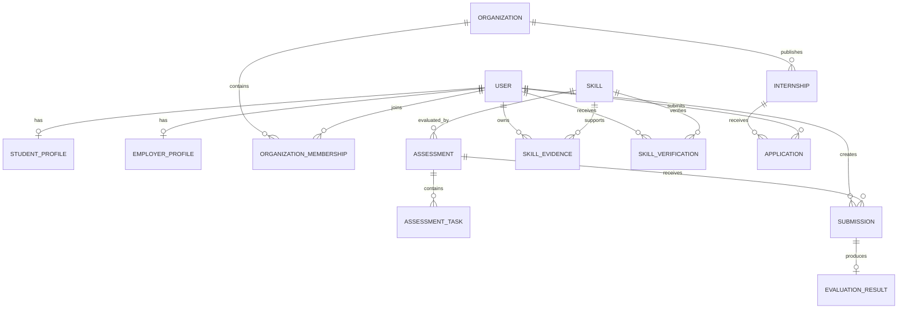
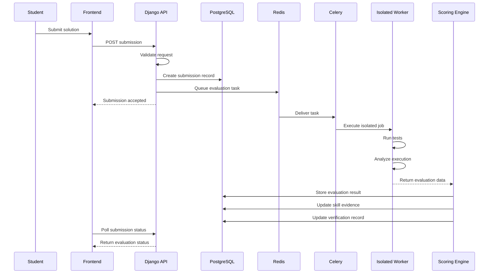
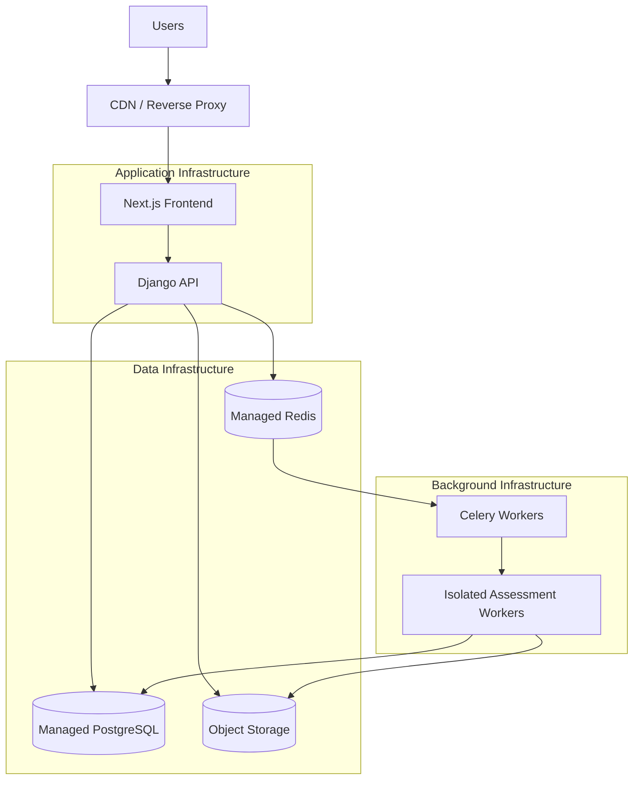

# Technical Architecture Document (TAD)
## SkillProof — Verified Skills & Project-Based Hiring Platform

**Document Version:** 1.0  
**Status:** Proposed Architecture  
**Project Type:** Final Year Project (FYP) + SaaS Startup  
**Architecture Style:** Modular Monolith with Asynchronous Workers  
**Frontend:** Next.js, TypeScript, Tailwind CSS  
**Backend:** Django, Django REST Framework  
**Database:** PostgreSQL  
**Task Queue:** Celery  
**Message Broker / Cache:** Redis  
**Code Execution:** Isolated Docker Workers  
**External Integration:** GitHub OAuth and REST API

---

# 1. Introduction

## 1.1 Purpose

This document describes the technical architecture of SkillProof, a web-based platform designed to verify practical software engineering skills through coding assessments, project analysis, automated evaluation, and evidence-based competency scoring.

The document defines:

- System architecture
- Application components
- Backend module organization
- Database architecture
- API design
- Assessment execution workflow
- Skill verification workflow
- Security architecture
- Infrastructure and deployment
- Scalability and reliability
- Technical constraints and architectural decisions

This document serves as the technical blueprint for implementation, testing, deployment, and future system evolution.

## 1.2 System Overview

SkillProof consists of four primary user-facing areas:

1. Student Dashboard
2. Employer Dashboard
3. University Dashboard
4. Administration Dashboard

The platform provides a centralized system where students demonstrate their skills, employers discover qualified candidates, and universities monitor practical student competencies.

The core technical capability is an assessment pipeline that accepts student submissions, executes automated tests in an isolated environment, analyzes code quality, and generates evidence-based skill reports.

## 1.3 Architectural Goals

The architecture shall prioritize:

- Security of student-submitted code
- Maintainability of backend modules
- Reliable asynchronous assessment execution
- Accurate and explainable skill scoring
- Secure multi-role access control
- Efficient candidate search
- Scalability for future SaaS growth
- Practical implementation within an FYP timeline

---

# 2. Architecture Overview

## 2.1 Selected Architecture

SkillProof will initially use a **Modular Monolith Architecture** supported by asynchronous background workers.

The main Django application will contain logically separated modules within a single backend deployment.

Assessment execution and resource-intensive analysis will be handled by separate worker processes.

This architecture provides a balance between:

- Simplicity of development
- Clear separation of responsibilities
- Reduced deployment complexity
- Future scalability
- Maintainable code organization

A microservices architecture is not required for the initial MVP because it would introduce unnecessary infrastructure and operational complexity.

## 2.2 High-Level Architecture Diagram

<escape>```mermaid
flowchart TB
    subgraph Clients
        S[Student Dashboard]
        E[Employer Dashboard]
        U[University Dashboard]
        A[Admin Dashboard]
    end

    subgraph Frontend
        FE[Next.js Application]
    end

    subgraph Backend
        API[Django REST API]
        AUTH[Authentication and RBAC]
        PROFILE[Profile and Organization]
        ASSESS[Assessment Management]
        SUB[Submission Management]
        SCORE[Skill Scoring Engine]
        MATCH[Candidate Matching]
        JOB[Internship and Applications]
        GH[GitHub Integration]
    end

    subgraph Infrastructure
        DB[(PostgreSQL)]
        REDIS[(Redis)]
        CELERY[Celery Workers]
        EXEC[Isolated Execution Workers]
        STORAGE[Object Storage]
    end

    subgraph External
        GITHUB[GitHub API]
    end

    S --> FE
    E --> FE
    U --> FE
    A --> FE

    FE --> API

    API --> AUTH
    API --> PROFILE
    API --> ASSESS
    API --> SUB
    API --> SCORE
    API --> MATCH
    API --> JOB
    API --> GH

    AUTH --> DB
    PROFILE --> DB
    ASSESS --> DB
    SUB --> DB
    SCORE --> DB
    MATCH --> DB
    JOB --> DB
    GH --> GITHUB

    SUB --> REDIS
    REDIS --> CELERY
    CELERY --> EXEC
    EXEC --> SCORE

    API --> STORAGE
    EXEC --> STORAGE
```</escape>

## 2.3 Architectural Layers

### Presentation Layer

Responsible for user interaction and dashboard rendering.

Technology:

- Next.js
- TypeScript
- Tailwind CSS
- React

### Application Layer

Responsible for business logic and API processing.

Technology:

- Django
- Django REST Framework

### Domain Layer

Contains core business rules:

- Assessment evaluation
- Skill verification
- Evidence management
- Candidate matching
- Application workflows

### Infrastructure Layer

Responsible for:

- PostgreSQL
- Redis
- Celery
- Docker execution workers
- File storage
- External API integrations

---

# 3. Technology Stack

## 3.1 Frontend

| Technology | Purpose |
|---|---|
| Next.js | Web application framework |
| TypeScript | Type-safe frontend development |
| React | Component-based UI |
| Tailwind CSS | Styling |
| React Hook Form | Form management |
| Zod | Client-side validation |
| TanStack Query | API state and caching (using Axios for HTTP transport) |
| Recharts | Analytics visualization |

## 3.2 Backend

| Technology | Purpose |
|---|---|
| Python | Backend programming language |
| Django | Application framework |
| Django REST Framework | REST API implementation |
| SimpleJWT | JWT authentication |
| PostgreSQL | Primary relational database |
| Redis | Cache and task broker |
| Celery | Asynchronous task processing |

## 3.3 Assessment Infrastructure

| Technology | Purpose |
|---|---|
| Docker | Isolated execution environments |
| Celery Workers | Background processing |
| pytest | Automated testing |
| Ruff / Pylint | Python code analysis |
| Radon | Python complexity analysis |
| Coverage.py | Test coverage measurement |

The initial implementation will focus on Python-based assessments.

Additional language support may be introduced through separate execution images.

## 3.4 External Services

| Service | Purpose |
|---|---|
| GitHub API | Repository and contribution analysis |
| SMTP or email provider | Email verification and notifications |
| S3-compatible storage | Assessment files and reports |
| Monitoring service | Error tracking and performance monitoring |

---

# 4. Frontend Architecture

## 4.1 Frontend Structure

The Next.js application will use the App Router architecture.

Proposed directory structure:

```text
frontend/
├── app/
│   ├── (auth)/
│   │   ├── login/
│   │   ├── register/
│   │   └── verify-email/
│   │
│   ├── student/
│   │   ├── dashboard/
│   │   ├── assessments/
│   │   ├── submissions/
│   │   ├── skills/
│   │   └── profile/
│   │
│   ├── employer/
│   │   ├── dashboard/
│   │   ├── candidates/
│   │   ├── internships/
│   │   └── applications/
│   │
│   ├── university/
│   │   ├── dashboard/
│   │   └── analytics/
│   │
│   ├── admin/
│   │   ├── assessments/
│   │   ├── users/
│   │   └── moderation/
│   │
│   └── skills/
│       └── [username]/
│
├── components/
│   ├── ui/
│   ├── forms/
│   ├── dashboards/
│   ├── assessments/
│   └── skill-passport/
│
├── lib/
│   ├── api/
│   ├── auth/
│   ├── validation/
│   └── utilities/
│
├── hooks/
├── types/
└── stores/
```

## 4.2 Frontend Responsibilities

The frontend shall:

- Render dashboards based on user roles.
- Validate user input.
- Communicate with the backend API.
- Display assessment status.
- Present evaluation reports.
- Display skill evidence.
- Support candidate search and filtering.
- Handle authentication state.

The frontend shall not independently calculate authoritative skill scores.

All official scoring and verification decisions shall be performed by the backend.

## 4.3 Authentication Strategy

The frontend will communicate with Django REST Framework using JWT authentication.

Recommended approach:

- Short-lived access token
- Refresh token stored in a secure HttpOnly cookie
- Access token maintained in memory where practical
- Refresh endpoint for session renewal
- Logout endpoint for refresh-token invalidation

The implementation shall avoid storing long-lived authentication tokens in browser localStorage.

---

# 5. Backend Architecture

## 5.1 Backend Organization

The backend will be organized into Django applications based on business domains.

```text
backend/
├── config/
│   ├── settings/
│   ├── urls.py
│   ├── celery.py
│   └── asgi.py
│
├── apps/
│   ├── accounts/
│   ├── organizations/
│   ├── profiles/
│   ├── skills/
│   ├── assessments/
│   ├── submissions/
│   ├── evaluations/
│   ├── evidence/
│   ├── github_integration/
│   ├── hiring/
│   ├── analytics/
│   ├── notifications/
│   └── audit/
│
├── common/
│   ├── permissions/
│   ├── exceptions/
│   ├── validators/
│   └── utilities/
│
├── tests/
├── manage.py
└── requirements.txt
```

## 5.2 Backend Module Responsibilities

### Accounts Module

Responsible for:

- User registration
- Login and logout
- Email verification
- Password reset
- JWT authentication
- Role management

### Organizations Module

Responsible for:

- Company records
- University records
- Organization membership
- Employer authorization
- Institutional access control

### Profiles Module

Responsible for:

- Student profiles
- Employer profiles
- Public profile visibility
- Resume information
- Portfolio information

### Skills Module

Responsible for:

- Skill definitions
- Skill categories
- Skill levels
- Skill verification records
- Skill passport generation

### Assessments Module

Responsible for:

- Assessment creation
- Assessment publishing
- Task definitions
- Test case management
- Assessment scheduling

### Submissions Module

Responsible for:

- Submission creation
- File validation
- Submission metadata
- Execution status
- Submission history

### Evaluations Module

Responsible for:

- Automated test execution coordination
- Test result processing
- Code quality analysis
- Score normalization
- Evaluation report generation

### Evidence Module

Responsible for:

- Assessment evidence
- Skill evidence
- Project evidence
- Verification confidence
- Evidence expiration and revocation

### GitHub Integration Module

Responsible for:

- OAuth integration
- Repository synchronization
- Contribution analysis
- Repository permissions

### Hiring Module

Responsible for:

- Internship listings
- Candidate search
- Matching algorithms
- Shortlisting
- Applications

### Analytics Module

Responsible for:

- Student competency reports
- University analytics
- Employer usage metrics
- Assessment statistics

### Audit Module

Responsible for:

- Administrative action logs
- Security events
- Assessment changes
- Verification changes

---

# 6. Database Architecture

## 6.1 Database Selection

PostgreSQL will be used as the primary database.

Reasons:

- Strong relational integrity
- Transaction support
- Flexible indexing
- JSONB support
- Full-text search capabilities
- Suitable for multi-tenant SaaS data
- Reliable integration with Django ORM

## 6.2 Core Database Entities

### User

Stores authentication and identity information.

Fields:

- id: UUID
- email
- password
- role
- is_active
- is_verified
- created_at
- updated_at

### StudentProfile

Stores student-specific information.

Fields:

- id
- user_id
- university_id
- degree_program
- graduation_year
- biography
- github_username
- linkedin_url
- visibility

### Organization

Stores company and university records.

Fields:

- id
- name
- organization_type
- website
- description
- created_at

### OrganizationMembership

Associates users with organizations.

Fields:

- id
- organization_id
- user_id
- membership_role
- status

### Skill

Defines technical competencies.

Fields:

- id
- name
- category
- description

### Assessment

Stores assessment definitions.

Fields:

- id
- title
- description
- skill_id
- difficulty
- time_limit
- status
- created_by

### AssessmentTask

Stores individual tasks within an assessment.

Fields:

- id
- assessment_id
- title
- instructions
- task_type
- evaluation_configuration

### Submission

Stores student submissions.

Fields:

- id
- student_id
- assessment_id
- source_type
- source_location
- status
- submitted_at

### EvaluationResult

Stores evaluation outcomes.

Fields:

- id
- submission_id
- functional_score
- quality_score
- testing_score
- security_score
- total_score
- execution_status
- completed_at

### SkillEvidence

Stores evidence supporting a competency.

Fields:

- id
- student_id
- skill_id
- evidence_type
- source_id
- score
- confidence
- created_at

### SkillVerification

Stores verified skill records.

Fields:

- id
- student_id
- skill_id
- verified_score
- confidence_score
- verification_status
- last_verified_at

### Internship

Stores internship listings.

Fields:

- id
- organization_id
- title
- description
- required_skills
- location
- application_deadline
- status

### Application

Stores internship applications.

Fields:

- id
- internship_id
- student_id
- status
- applied_at

## 6.3 Database Relationships



## 6.4 Data Integrity

The database shall enforce:

- Foreign key relationships
- Unique email addresses
- Unique organization membership where appropriate
- Valid assessment status transitions
- Valid application status transitions
- Referential integrity for evaluation results
- Transactional updates for verification records

---

# 7. Assessment Execution Architecture

## 7.1 Overview

The assessment execution system is the most security-sensitive component of SkillProof.

Student-submitted code shall never execute directly inside the Django API process.

The system will use asynchronous processing and isolated execution workers.

## 7.2 Execution Workflow



## 7.3 Submission Lifecycle

A submission shall follow these states:

1. Pending
2. Queued
3. Running
4. Completed
5. Failed
6. Cancelled

The backend shall validate state transitions.

A submission cannot transition directly from Pending to Completed without passing through the evaluation process.

## 7.4 Execution Worker Responsibilities

The worker shall:

- Receive an authorized submission reference.
- Retrieve submission files.
- Create an isolated execution environment.
- Install or use predefined dependencies.
- Run assessment test cases.
- Collect execution metrics.
- Run supported static analysis.
- Return structured evaluation results.
- Destroy the execution environment.

## 7.5 Execution Security

The execution environment shall implement:

- CPU limits
- Memory limits
- Execution time limits
- Filesystem restrictions
- Process limits
- Restricted network access
- Non-root execution
- Temporary workspaces
- Automatic cleanup

For production deployment, stronger sandboxing may be required beyond standard Docker isolation.

Student code shall not have access to:

- Production database credentials
- Redis credentials
- Django secret keys
- Internal service credentials
- Host filesystem contents
- Other students' submissions

---

# 8. Skill Verification Engine

## 8.1 Purpose

The Skill Verification Engine converts assessment results and project evidence into structured competency records.

It shall not rely exclusively on a single coding test or an opaque AI-generated score.

## 8.2 Evaluation Dimensions

The initial scoring model may include:

| Dimension | Weight |
|---|---:|
| Functional Correctness | 30% |
| Problem Solving | 20% |
| Code Quality | 15% |
| Testing | 15% |
| Security and Best Practices | 10% |
| Project Contribution Evidence | 10% |

The weights shall be configurable and evaluated during the research phase.

## 8.3 Score Calculation

A weighted competency score may be calculated as:

\[
S = \sum_{i=1}^{n} w_i s_i
\]

Where:

- \(S\) represents the competency score.
- \(w_i\) represents the weight of an evaluation dimension.
- \(s_i\) represents the normalized score of that dimension.

All dimensions shall be normalized to a consistent scale before aggregation.

## 8.4 Verification Confidence

Skill score and verification confidence shall be stored separately.

A student may demonstrate a high score in one assessment while having limited supporting evidence.

The confidence model may consider:

- Number of completed assessments
- Assessment difficulty
- Evidence diversity
- Evidence recency
- Consistency between results
- Human evaluator confirmation

Confidence shall not be presented as a statistically calibrated probability unless the model has been validated for that interpretation.

## 8.5 Evidence Model

Each verified skill shall reference supporting evidence.

Evidence types may include:

- Coding assessment
- Project assessment
- Code review
- GitHub contribution
- Human evaluation
- Practical debugging task

The system shall retain the source and evaluation criteria associated with each evidence record.

---

# 9. Candidate Matching Architecture

## 9.1 Matching Objective

The Candidate Matching Engine will recommend candidates whose verified skills align with an employer's internship or job requirements.

The engine shall provide recommendations rather than make automatic hiring decisions.

## 9.2 Matching Inputs

- Required skills
- Minimum competency levels
- Assessment evidence
- Project experience
- Availability
- Graduation year
- Location or remote preference

## 9.3 Matching Strategy

The MVP shall use a transparent weighted matching algorithm.

Example:

\[
M = \sum_{i=1}^{n} r_i v_i
\]

Where:

- \(M\) is the matching score.
- \(r_i\) is the importance of a required skill.
- \(v_i\) is the candidate's verified competency for that skill.

The final score shall be normalized to a consistent scale.

## 9.4 Matching Constraints

The system shall:

- Avoid using protected personal characteristics.
- Explain the primary matching factors.
- Allow employers to inspect evidence.
- Support manual candidate review.
- Avoid presenting ranking as a guarantee of job performance.

---

# 10. GitHub Integration Architecture

## 10.1 Integration Purpose

GitHub integration will provide supplementary evidence of software development activity.

It will not independently establish a verified skill.

## 10.2 Integration Workflow

1. Student initiates GitHub OAuth authorization.
2. GitHub grants authorized access.
3. SkillProof stores the necessary integration metadata.
4. The backend retrieves permitted repository information.
5. Repository activity is analyzed.
6. Contribution evidence is generated.
7. The student reviews and approves profile inclusion.

## 10.3 Contribution Metrics

Potential metrics include:

- Commits
- Pull requests
- Code review activity
- Repository participation
- Files changed
- Test additions
- Documentation contributions

The system shall avoid treating raw commit count as a reliable measure of engineering skill.

---

# 11. API Architecture

## 11.1 API Design

The backend shall expose a versioned REST API.

Base URL:

```text
/api/v1/
```

API conventions:

- JSON request and response bodies
- HTTP status codes
- Pagination
- Filtering
- Authentication
- Role-based authorization
- Consistent error responses

## 11.2 Authentication Endpoints

```text
POST   /api/v1/auth/register/
POST   /api/v1/auth/login/
POST   /api/v1/auth/logout/
POST   /api/v1/auth/token/refresh/
POST   /api/v1/auth/verify-email/
POST   /api/v1/auth/password-reset/
```

## 11.3 Profile Endpoints

```text
GET    /api/v1/students/me/
PATCH  /api/v1/students/me/
GET    /api/v1/students/{id}/
GET    /api/v1/skills/passport/{username}/
```

## 11.4 Assessment Endpoints

```text
GET    /api/v1/assessments/
GET    /api/v1/assessments/{id}/
POST   /api/v1/assessments/
PATCH  /api/v1/assessments/{id}/
POST   /api/v1/assessments/{id}/publish/
```

Assessment creation and publishing shall be restricted to authorized users.

## 11.5 Submission Endpoints

```text
POST   /api/v1/submissions/
GET    /api/v1/submissions/
GET    /api/v1/submissions/{id}/
POST   /api/v1/submissions/{id}/cancel/
```

## 11.6 Evaluation Endpoints

```text
GET    /api/v1/submissions/{id}/results/
GET    /api/v1/students/me/evaluations/
GET    /api/v1/students/me/skills/
```

Evaluation results shall be read-only for students and employers.

## 11.7 Employer Endpoints

```text
GET    /api/v1/employers/candidates/
POST   /api/v1/employers/shortlists/
GET    /api/v1/employers/shortlists/
```

## 11.8 Internship Endpoints

```text
GET    /api/v1/internships/
POST   /api/v1/internships/
GET    /api/v1/internships/{id}/
POST   /api/v1/internships/{id}/apply/
GET    /api/v1/applications/
PATCH  /api/v1/applications/{id}/status/
```

## 11.9 API Security

All protected endpoints shall:

- Require authentication.
- Enforce role-based permissions.
- Validate request data.
- Apply appropriate rate limits.
- Avoid exposing internal database identifiers unnecessarily.
- Record sensitive administrative actions.

---

# 12. Authentication and Authorization

## 12.1 Role-Based Access Control

SkillProof shall implement Role-Based Access Control (RBAC).

### Student Permissions

- Manage own profile
- View assessments
- Submit assessments
- View own results
- Manage skill passport
- Apply for internships

### Employer Permissions

- Manage organization profile
- Create internship listings
- Search authorized candidates
- View permitted skill evidence
- Manage applications

### University Permissions

- View authorized institutional analytics
- Manage university profile
- Monitor participating students

### Administrator Permissions

- Manage users
- Manage assessments
- Moderate content
- Review audit records
- Manage platform configuration

## 12.2 Multi-Tenant Isolation

Organizations shall be logically isolated.

The backend shall validate organization membership before allowing access to organization-specific resources.

A user belonging to one company shall not access another company's private internship applications or candidate records.

---

# 13. Security Architecture

## 13.1 Security Principles

The platform shall follow:

- Least privilege
- Defense in depth
- Secure defaults
- Data minimization
- Separation of duties
- Explicit authorization

## 13.2 Application Security

Security controls shall include:

- Secure password hashing
- HTTPS
- JWT validation
- Refresh-token protection
- CORS configuration
- Input validation
- File upload validation
- Rate limiting
- SQL injection protection through parameterized ORM queries
- XSS prevention
- CSRF protection where applicable

## 13.3 Data Security

Sensitive information shall be protected through:

- Encryption in transit
- Secure secret management
- Restricted database access
- Access logging
- Backup encryption where supported
- Controlled retention policies

## 13.4 Assessment Security

The assessment infrastructure shall use a separate execution boundary.

The Django application shall only coordinate assessment execution and process returned results.

It shall not execute untrusted student code directly.

## 13.5 Privacy

The platform shall:

- Obtain consent for GitHub integration.
- Respect repository visibility.
- Allow students to control public profile information.
- Limit university access to authorized records.
- Avoid exposing private assessment content.
- Provide a mechanism for reporting inaccurate verification records.

---

# 14. Infrastructure and Deployment

## 14.1 Development Environment

The development environment shall use Docker Compose where practical.

Proposed services:

```text
services:
  frontend
  backend
  postgres
  redis
  celery-worker
  celery-beat
  assessment-worker
```

The assessment worker shall use a separate execution configuration and security boundary.

## 14.2 Production Deployment

The initial production architecture may use:

- Managed PostgreSQL
- Managed Redis
- Containerized Django API
- Containerized Next.js frontend
- Separate Celery workers
- Isolated assessment execution workers
- Object storage
- HTTPS reverse proxy
- Monitoring and logging

## 14.3 Deployment Diagram



## 14.4 Environment Configuration

The platform shall maintain separate environments:

- Development
- Testing
- Staging
- Production

Environment-specific secrets shall not be committed to source control.

---

# 15. Monitoring and Logging

## 15.1 Application Monitoring

The system shall monitor:

- API response times
- Error rates
- Database performance
- Worker queue depth
- Assessment execution duration
- Failed submissions
- Resource utilization

## 15.2 Logging

The platform shall maintain structured logs for:

- Authentication events
- Assessment execution
- API errors
- Administrative actions
- Integration failures
- Background task failures

Logs shall not contain passwords, access tokens, or unnecessary private student data.

## 15.3 Error Handling

The system shall:

- Return consistent API error responses.
- Retry recoverable background tasks.
- Avoid infinite task retries.
- Record permanent execution failures.
- Notify users of meaningful assessment errors.

---

# 16. Testing Strategy

## 16.1 Unit Testing

Unit tests shall cover:

- Scoring calculations
- Permission rules
- Validation logic
- Matching algorithms
- Status transitions

## 16.2 Integration Testing

Integration tests shall cover:

- Authentication workflows
- Assessment submission
- Evaluation result processing
- GitHub integration
- Internship application workflows

## 16.3 API Testing

API tests shall verify:

- Correct status codes
- Request validation
- Authorization
- Pagination
- Error handling

## 16.4 Security Testing

Security tests shall include:

- Unauthorized resource access
- Organization isolation
- Malicious file uploads
- Assessment sandbox restrictions
- Token expiration
- Rate-limit behavior

## 16.5 Performance Testing

Performance testing shall measure:

- Candidate search latency
- API response time
- Concurrent assessment submissions
- Background queue processing
- Database query efficiency

---

# 17. Scalability Strategy

## 17.1 Initial Scale

The MVP shall target a manageable pilot involving:

- 100–500 students
- 5–20 employers
- A limited assessment catalog
- A small number of supported execution languages

These are planning assumptions, not guaranteed capacity figures.

## 17.2 Scaling Approach

As usage increases, the platform may scale through:

- Additional API instances
- Additional Celery workers
- Separate assessment worker pools
- Database indexing
- Query optimization
- Redis caching
- CDN delivery
- Search infrastructure

## 17.3 Future Architecture Evolution

The modular monolith may later be separated into independent services if operational requirements justify it.

Potential future services:

- Assessment Execution Service
- Skill Verification Service
- Candidate Matching Service
- GitHub Analysis Service
- Notification Service

Service separation shall be based on measured bottlenecks and independent scaling requirements.

---

# 18. Architectural Decisions

## ADR-01: Modular Monolith Instead of Microservices

**Decision:** Use a modular monolith for the initial backend.

**Reason:**

- Easier development
- Simpler deployment
- Lower operational complexity
- Suitable for an FYP team
- Clear internal module boundaries

## ADR-02: PostgreSQL as Primary Database

**Decision:** Use PostgreSQL.

**Reason:**

- Relational data integrity
- Strong transaction support
- Complex query support
- Suitable for organization and assessment relationships

## ADR-03: Celery for Asynchronous Processing

**Decision:** Use Celery and Redis.

**Reason:**

- Assessment execution is time-consuming.
- API requests should remain responsive.
- Background jobs support retries and task monitoring.

## ADR-04: Isolated Code Execution

**Decision:** Execute student code in isolated workers.

**Reason:**

- Student submissions are untrusted.
- Code execution requires resource restrictions.
- Application credentials must remain protected.

## ADR-05: Evidence-Based Scoring

**Decision:** Store assessment evidence and skill scores separately.

**Reason:**

- Improves transparency.
- Supports verification confidence.
- Enables future scoring-model improvements.
- Allows employers to inspect the basis of a competency score.

## ADR-06: REST API

**Decision:** Use a versioned REST API.

**Reason:**

- Simple integration with Next.js.
- Familiar development model.
- Easy API testing and documentation.
- Suitable for the initial product scope.

---

# 19. Technical Constraints

The initial system shall operate within the following constraints:

- Limited development time associated with the FYP.
- Limited infrastructure budget.
- Restricted number of supported programming languages.
- Limited initial assessment dataset.
- Dependence on GitHub API permissions and rate limits.
- Need for secure code execution infrastructure.
- Need for human validation of the proposed scoring model.

The MVP shall prioritize a secure and reliable assessment pipeline over a large number of secondary features.

---

# 20. Conclusion

SkillProof will be implemented using a modular, scalable architecture centered around Django REST Framework, PostgreSQL, Celery, Redis, and isolated assessment workers.

The architecture separates user-facing application logic from resource-intensive and security-sensitive code execution.

The platform's core technical contribution will be an evidence-based skill verification engine that combines practical assessment results, code quality analysis, testing performance, and project contribution evidence.

The proposed architecture provides a foundation for:

- A functional Software Engineering FYP
- A secure assessment platform
- A verified skill passport
- Employer candidate discovery
- University employability analytics
- A future SaaS startup

**Architectural Vision:** Build a secure and scalable system that transforms demonstrated software engineering capabilities into structured, verifiable, and useful career evidence.